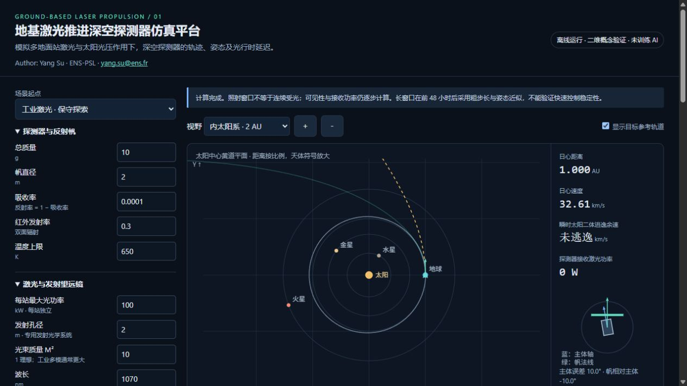

# Solar Sail Lab

**Author:** Yang Su · ENS-PSL · [yang.su@ens.fr](mailto:yang.su@ens.fr)

## [▶ Open the simulator / 打开模拟器](https://yangsssu.github.io/solar-sail-lab/)

**Click the link above or the preview below to launch. No installation or sign-in required.**

An interactive, browser-based solar/laser sail concept simulator. The interface is in Chinese. Runs entirely in the visitor's browser with no backend, account, installation, or external JavaScript dependencies.

## Use

Open `index.html` locally, or [launch the online simulator](https://yangsssu.github.io/solar-sail-lab/). Adjust parameters, click **计算轨迹** (Calculate trajectory), then play or scrub the timeline. CSV trajectory and JSON parameter exports are generated locally. Parameters are not shared between visitors or saved to a server.

Features include a Sun-centered orbital view, eight planets and the Moon, solar radiation pressure, laser propagation and light-time delays, simplified sail attitude control, and 1–12 configurable ground stations. Each station can have its own projected longitude, power, altitude, atmospheric transmission, availability coefficient, and pointing error. Stations can illuminate simultaneously or hand over as Earth rotates.

## Publish on GitHub Pages

1. Create a public repository, for example `solar-sail-lab`.
2. Put `index.html` and `.nojekyll` at the repository root on `main`.
3. Open **Settings → Pages**.
4. Set **Source → Deploy from a branch**, choose **main** and **/(root)**, and save.
5. Wait for deployment to finish. GitHub displays the public site URL there.

The usual project URL is `https://yangsssu.github.io/solar-sail-lab/`. The simulator is live at this address.

Reference: https://docs.github.com/en/pages/getting-started-with-github-pages/configuring-a-publishing-source-for-your-github-pages-site

## Scientific limitations

This is an educational research prototype, not a mission-design or flight-navigation tool. No reinforcement-learning model has been trained.

- Dynamics are planar. Planetary orbits are circular with illustrative phases, not dated ephemerides.
- Ground stations use an equatorial planar projection; real latitude and Earth's axial tilt are not modeled.
- A Gaussian-envelope approximation represents beam propagation and interception. Real multimode profiles, turbulent propagation, and coherent combining are not resolved.
- Attitude control is a simplified single-axis model, not a validated three-axis or flexible-sail controller.
- Long illumination windows use coarser integration after the first 48 hours. These results cannot establish second-scale beam-riding stability. Long-term display and CSV samples are downsampled.
- Thermal behavior is a lumped approximation. Optimistic low-mass presets are hypotheses, not manufactured hardware specifications.
- The dashed escape reference starts with an idealized higher velocity; it is not an achieved guidance solution. A rocket-escape preset is not evidence that lasers supplied that escape energy.
- Positive instantaneous solar two-body energy is a diagnostic, not a guarantee of a stellar encounter.

Further assumptions and sources are available inside the simulator. Always examine received power separately from emitted power, and use step-size sensitivity checks.

## Implementation

`index.html` contains the styles, physics engine, and interface scripts. `.nojekyll` allows GitHub Pages to serve the static files without Jekyll processing. No build command is required.
